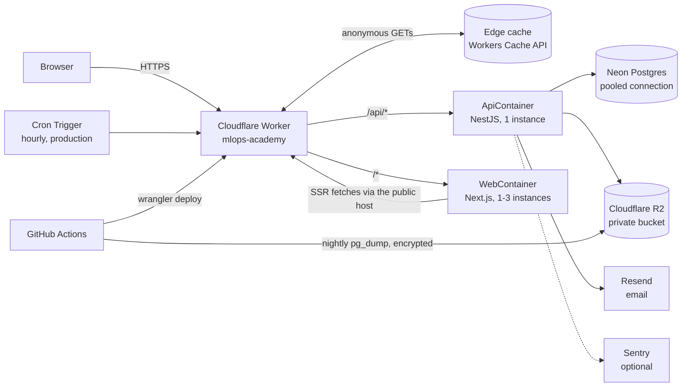
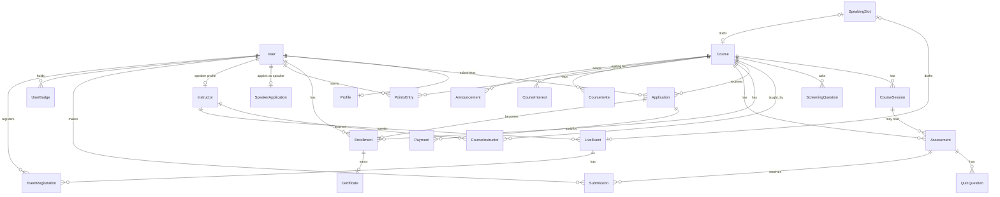

# MLOps MENA Academy: engineering guide

How the academy is built, deployed and changed. What it does for users is in
[FEATURES.md](FEATURES.md). Deployment runbooks are in [DEPLOY.md](../DEPLOY.md) and day-to-day
operations in [OPERATIONS.md](../OPERATIONS.md); this guide links to them instead of repeating them.
Where this guide and the code disagree, the code wins: fix the guide in the same PR.

## Contents

1. [Architecture](#1-architecture)
2. [Monorepo layout](#2-monorepo-layout)
3. [Tech stack and versions](#3-tech-stack-and-versions)
4. [Request flow](#4-request-flow)
5. [Authentication and authorisation](#5-authentication-and-authorisation)
6. [Data model](#6-data-model)
7. [Migrations policy](#7-migrations-policy)
8. [Jobs and cron](#8-jobs-and-cron)
9. [Email pipeline](#9-email-pipeline)
10. [Storage](#10-storage)
11. [Caching](#11-caching)
12. [i18n and RTL](#12-i18n-and-rtl)
13. [Testing](#13-testing)
14. [CI/CD and release](#14-cicd-and-release)
15. [Environments and configuration](#15-environments-and-configuration)
16. [Observability](#16-observability)
17. [Security practices](#17-security-practices)
18. [Performance and load testing](#18-performance-and-load-testing)
19. [Cost constraints and Workers Builds](#19-cost-constraints-and-workers-builds)
20. [How to add a feature](#20-how-to-add-a-feature)

---

## 1. Architecture

One Cloudflare Worker per environment fronts two Cloudflare Containers: the Next.js web app and the
NestJS API. The API is the only component that talks to the database, the bucket and the email
provider.

- **Worker** (`deploy/cloudflare/src/index.ts`): routes `/api/*` to the API container and everything
  else to the web container, redirects other hosts and plain HTTP to the canonical host, applies the
  edge cache (`edge-cache.ts`), turns container failures into `503` with `Retry-After`
  (`container-fetch.ts`), adds `noindex` outside production (`robots.ts`), and on the hourly Cron
  Trigger calls `POST /api/internal/jobs/tick` with the jobs token.
- **Containers** sleep when idle (`SLEEP_AFTER`: 15 minutes in production, 10 on staging). The first
  request after a sleep waits a few seconds. The API is exactly one instance (`max_instances: 1`)
  because rate limits and the login lockout are in memory; the web app is stateless, up to three
  instances, spread by `WEB_INSTANCES` (1 today).
- **Neon Postgres** (Frankfurt), one project: `neondb` for production, `academy_staging` with its own
  role for staging.
- **R2**: `academy-private` (production) and `academy-staging-private`, each with its own token.
- **Resend** sends from `academy@mlopsmena.com` (SPF/DKIM on `send.mlopsmena.com`).

## 2. Monorepo layout

pnpm workspaces:

| Path | Package | Role |
|---|---|---|
| `apps/api` | `@academy/api` | NestJS REST API under `/api`, Prisma schema, migrations, seed and archive import, React Email templates, scheduled jobs. Swagger at `/api/docs` (dev; production only with `API_DOCS=true`) |
| `apps/web` | `@academy/web` | Next.js App Router site under `/[locale]/…`: public pages (static/ISR), student dashboard and learn page, speaker portal, admin panel. Content files (`src/content`: policies, roadmaps), learning paths (`src/lib/paths.ts`), messages (`src/i18n/messages/{en,ar}.json`) |
| `packages/shared` | `@academy/shared` | The single source of truth used by both apps: enums (kept in sync with Prisma by a test), zod schemas, bilingual labels, the application state machine, and pure rules (points weeks and ranking, certificate eligibility, quiz sheet parsing, admin permissions, CSV, time zones) |
| `deploy/cloudflare` | `@academy/deploy-cloudflare` | Worker source, `wrangler.jsonc` (production at the top level, `env.staging`), `configure-host.mjs`, setup scripts |
| `e2e/` | — | Playwright browser tests (main flow, accessibility, cache headers, feature flows) |
| `loadtest/` | — | Locust load tests |
| `.github/workflows/` | — | CI, release to staging, release to production, the reusable deploy, nightly backup |
| `docker-compose.yml` | — | Local stack: Postgres 16, MinIO, Mailpit, api, web |

API modules (`apps/api/src/*`), one folder each: `auth`, `users` (profile, account, admin accounts),
`courses`, `applications` (workflow), `payments`, `learn`, `assessments`, `certificates`, `points`,
`events` (live sessions), `calendar` (private feeds), `waitlist`, `invites` (enrol by email),
`announcements` (durable delivery), `telegram` (course groups through the bot), `speaker-portal`, `speaker-announcements`, `teaching` (speakers'
course routes), `course-access` (who may teach a course), `admin`, `admin-team`, `media`, `archive`,
`funnel`, `notifications`, `settings`, `audit`, `email`, `storage`, `jobs`, `health`, `prisma`,
`config`, `common` (guard, decorators, public cache, throttler, load shedding).

## 3. Tech stack and versions

| Layer | Choice | Version |
|---|---|---|
| Runtime | Node.js (Alpine images) | 24 |
| Package manager | pnpm | 10.34 |
| Language | TypeScript | 5.9 |
| Web | Next.js App Router, React, Tailwind CSS | 15.5.27, 19.2.8, 4.1.18 |
| API | NestJS, class-validator + zod pipes | 11.2 |
| ORM / DB | Prisma on PostgreSQL (Neon; Postgres 16 locally) | 6.19 |
| Validation | zod | 3.25 |
| Passwords | argon2id via `@node-rs/argon2` | 2.0 |
| Email | Resend, React Email templates | resend 6.32 |
| Storage | S3 API (`@aws-sdk/client-s3`) on R2 / MinIO | 3.x |
| PDF | PDFKit (certificates) | 0.17 |
| Errors | Sentry for NestJS (optional) | 11.5 |
| Tests | Jest (API), Vitest (web, shared), Playwright + axe | 30, 3.2, 1.56 |
| Edge | Cloudflare Workers + Containers, wrangler | compat date 2026-09-15 |

Major upgrades (Next 16, Nest 12, Prisma 7, TypeScript 7) are deliberate, separate tasks.

## 4. Request flow

1. The browser calls `https://academy.mlopsmena.com/...`. Paths without a locale are redirected by the
   web middleware to `/{locale}/...` (cookie `NEXT_LOCALE`, else English).
2. The Worker checks the edge cache for anonymous GETs (no session cookie, no `Origin`); a hit returns
   with `x-edge-cache: HIT`.
3. On a miss, `/api/*` goes to the API container; anything else to a web container.
4. Public pages are ISR (revalidate 60 s; home, login, register 300 s) and fetch their data from the
   API over the public host (`API_INTERNAL_URL` is `https://<host>`), so those fetches also benefit
   from the edge-cached public API. Signed-in areas render in the browser and call `/api/*` with the
   session cookies.
5. In the API: the global auth guard → the throttler → zod/class-validator pipes → the controller →
   services → Prisma. Every response carries `X-Request-Id`. Beyond 200 requests in flight, or when no
   DB connection is free within 5 s, the API answers `503 BUSY` with `Retry-After`.

## 5. Authentication and authorisation

- **Passwords:** argon2id (`memoryCost 19456 KiB, timeCost 2, parallelism 1`, OWASP's minimum), hashed
  one at a time behind a gate (`PASSWORD_HASH_CONCURRENCY`). Hashes are one-way: nobody can read a
  password back.
- **Sessions:** a 15-minute JWT access token in the httpOnly `access_token` cookie (SameSite=Lax), and an
  opaque refresh token (30 days) in `refresh_token`, scoped to `/api/auth`, stored as a SHA-256 hash and
  rotated on every use. Reusing a rotated refresh token revokes its whole login family. `has_session`
  (no secret) lets the page know a session exists; `oauth_state` protects the Google flow.
- **Token versions:** access tokens carry `tokenVersion`; the guard compares it with the database on
  every request. Changing the password, deleting the account, Google claiming an unverified account and
  refresh-token theft bump it, so every issued token stops at once.
- **Google OAuth:** `GET /api/auth/google` → Google → `/api/auth/google/callback`. Only verified Google
  emails; claiming an unverified local account strips its password and sessions first. The
  student/speaker choice rides in the OAuth state.
- **Email verification** tokens (24 h) and **password reset** tokens (1 h; admin-created accounts get a
  7-day welcome link) are stored hashed. A reset also verifies the email and claims invites.
- **Re-authentication:** password change and account deletion need the current password, or a Google
  sign-in within 10 minutes for Google-only accounts.
- **The guard** (`apps/api/src/common/auth.guard.ts`): every route needs a session unless `@Public()`.
  `@Roles(...)` limits roles (`STUDENT`, `SPEAKER`, `ADMIN`). For admins, `@AdminCan(...)` lists the
  permission presets allowed; `SUPER` passes everything; a route open to ADMIN without `@AdminCan` is
  SUPER-only (default deny). Role and presets are read from the database on every request.
  `common/admin-routes.spec.ts` fails if an admin route has no tag and pins the CONTENT preset's reach.
  Speaker course routes add `TeachesCourseGuard` (`CourseAccessService.canTeach`). Details:
  [ADMIN-ROLES.md](ADMIN-ROLES.md).
- **Lockout and rate limits:** 10 failed logins in 15 minutes lock an account; 300 requests a minute per
  account (or IP), stricter per route (see OPERATIONS.md).

## 6. Data model

`apps/api/prisma/schema.prisma` (enums mirror `packages/shared/src/enums.ts`, checked by
`test/enums-sync.spec.ts`). Main groups:

- **Users and auth:** `User` (role, `adminPermissions`, `tokenVersion`, soft delete `deletedAt`,
  `anonymizedAt`), `RefreshToken`, `EmailVerificationToken`, `PasswordResetToken`, `Profile`,
  `SkillRating`, `CalendarFeed`.
- **Courses:** `Course` (status, type, price, capacity, dates, certificate rule), `CourseSession`,
  `ScreeningQuestion`, `Instructor` (public speaker page; `userId` links a speaker account),
  `CourseInstructor` (also "assigned to teach").
- **Admissions:** `Application` (status, answers, profile snapshot, `ref`), `ApplicationStatusHistory`,
  `Payment`, `Enrollment`, `CourseInvite`, `CourseInterest` (waiting list), `AdminNote`, `SavedFilter`,
  `FunnelEventLog`.
- **Learning:** `SessionProgress`, `SessionFeedback`, `ReminderPreference` (reminder and feedback-email
  opt-outs per course), `ReminderLog`, `Announcement`, `AnnouncementRecipient`, `Notification`.
- **Assessments:** `Assessment`, `QuizQuestion`, `QuizOption`, `Submission`, `AssessmentReminderLog`.
- **Certificates:** `Certificate` (one per enrolment; snapshots; `ON DELETE RESTRICT`).
- **Points:** `PointsEntry` (append-only ledger), `Badge`, `UserBadge`, `LeaderboardOptIn`.
- **Live sessions and speakers:** `LiveEvent`, `LiveEventSpeaker`, `EventRegistration`,
  `EventReminderLog`, `EventConfirmation`, `SpeakerApplication`, `SpeakingSlot`.
- **Platform:** `Setting` (key → JSON), `AuditLog`, `OutboundEmail` (the email outbox, section 9).

Conventions: ids are cuids; times are UTC; users are soft-deleted and anonymised after 30 days, never
hard-deleted while records reference them (`Restrict` on applications, payments, enrolments,
certificates); every status change goes through a service (the application state machine in
`packages/shared/src/state-machine.ts` is the only writer of `Application.status`).

## 7. Migrations policy

- **Additive only.** Each migration adds tables, nullable columns, enum values or indexes. Every
  migration since launch has been additive; PR descriptions state it under "Production impact".
- **Expand, then contract.** Rolling the code back never rolls the database back, so the previous
  release must work with the new schema. Rename or drop only in a later release, once nothing reads the
  old column (DEPLOY.md, "Roll back"). The one known exception is documented in OPERATIONS.md (PR #13).
- **Names sort by timestamp** (`YYYYMMDDhhmmss_name`); a new one must sort after the latest on `main`.
  `src/migrations-order.spec.ts` (unit tests, CI) checks the names, that timestamps strictly increase,
  and, when `origin/main` is available, that new folders sort after every migration on it. Parallel PRs
  take pre-assigned slots so they never collide.
- **No new enums for state:** new status-like columns are `text` with a `CHECK` constraint (e.g.
  `OutboundEmail.status`), so adding a value never needs an `ALTER TYPE` the previous release can't read.
- **Applied on start:** the API checks for pending migrations and runs `prisma migrate deploy` only when
  needed, then starts the idempotent seed and archive import in the background under an advisory lock.
- Backfills for new columns go in the migration itself (for example `adminPermissions = {SUPER}` for
  existing admins in PR #59).

## 8. Jobs and cron

Containers sleep, so in-process cron is off in production (`JOBS_ENABLED=false`); the Worker's Cron
Trigger (`0 * * * *`) calls `POST /api/internal/jobs/tick` with the `x-jobs-token` header (constant-time
check; 404 when no token is set). Staging has no cron: run `POST /_jobs/tick` with staging's token by
hand. Each job is idempotent and isolated (one failing doesn't stop the others):

| Job | What it does |
|---|---|
| `anonymised` | Anonymise accounts deleted more than 30 days ago |
| `profileReviewEmails` | Ask students with a profile untouched for 182 days to review it |
| `retention` | Delete payment screenshots, CVs and assessment files older than `screenshotRetentionDays` (180); delete pending/revoked invites older than 180 days |
| `remindersSent` | Course session reminders 24 h (window 22–24 h) and 1 h (10–75 min) before; `ReminderLog` makes each send once |
| `eventRemindersSent` | The same for live sessions (`EventReminderLog`) |
| `assessmentRemindersSent` | "Due in 24 hours" to students who haven't submitted (`AssessmentReminderLog`) |
| `points` | Re-sync assessment points for work changed in the last 26 h; Top of the week / Top of the course for closed weeks and ended courses (never before `pointsLaunchedAt`, once, within 14 days); Speaker badge |
| `announcementEmailsPending` | Resume announcement emails left pending by a restart |
| `feedbackPromptsQueued` | Registered. Feedback prompts for sessions that ended 30 min–72 h ago (outbox rows + notifications) |
| `consultationRemindersQueued` / `consultationScreenshotsDeleted` | Registered. Queue the 24 h (22–24 h) and 1 h (10–75 min) reminders for booked consultations (outbox dedupe keys, with the call's time, make each send once), and delete consultation payment screenshots older than `screenshotRetentionDays` (never one waiting for review) |
| `automationActions` | Registered. Course automation rules (`src/automation/`): each rule that is on in an active, unpaused course is evaluated (`engine.ts`), what it already did is dropped (`AutomationFiring`, unique per rule and occasion, is the log and the marker), then it enqueues student messages (outbox category `automation`, opt-out `reminders`; quiet hours; 3 a day), writes notifications, alerts the course team, syncs bonus points (source `AUTOMATION`) and issues certificates when set to. Never changes an application (a unit test checks the code) |
| `telegramJoinRequestsApproved` | Registered. Telegram course groups (`src/telegram/`): approves join requests that waited for their Telegram account to be connected or its owner to enrol (only waiting rows are read), and forgets requests older than 30 days. Never declines a request or removes anyone from a group. Off without `TELEGRAM_BOT_TOKEN` |
| `outboxPending` / `outboxPurged` | Registered. Start sending the email outbox (after the response); delete old finished rows |

**Jobs registry.** New jobs don't touch `jobs.controller.ts`: a provider decorated with
`@ScheduledJob('<resultKey>')` (`src/jobs/jobs-registry.ts`) and implementing `run(now)` is found at
startup by `JobsRegistry` (Nest's `DiscoveryService`: a multi-provider) and run by the tick after the
hand-listed jobs above, each isolated like them. With `JOBS_ENABLED` (local, compose) an in-process cron
runs them every 10 minutes. **Registered jobs only enqueue** (outbox rows, notifications) and return in
seconds; sending happens after the tick has answered, so the tick stays well inside the Worker's
5-minute fetch timeout. The cron stays hourly: a more frequent one would keep the container and Neon
awake. If prompts ever need to be faster, a gated "next due at" cron should wake the container only
when work is due.

The nightly database backup is a GitHub Actions workflow, not a tick (`backup.yml`, 01:30 UTC).

## 9. Email pipeline

- `EmailService.send(to, locale, template, { bulk })` renders a React Email template
  (`apps/api/src/email/templates/catalog.tsx`, English and Arabic) to HTML and text and queues it.
- **Two lanes, one paced queue:** transactional (verification, reset, status changes, booking
  confirmations) always goes before bulk (announcements, reminders, grades, badges, certificates). The
  queue spaces sends 550 ms apart for Resend's ~2 requests/second limit and retries retryable errors
  twice (1 s, 3 s). It lives in memory in the single API instance.
- **Durable fan-out:** announcements and waiting-list notices write one `AnnouncementRecipient` (or
  `CourseInterest`) row per person with a delivery status, so a restart resumes them (the tick).
- **Email outbox** (`src/outbox/`): the general durable queue, used by feedback prompts and assessment
  publish notices (announcements move onto it later).
  - `Outbox.enqueue(messages, tx?)` writes one `OutboundEmail` row per email in the caller's
    transaction (`createMany … skipDuplicates`). `dedupeKey` is unique (e.g. `feedback:<session>:<user>`),
    so enqueuing twice is a no-op and the row doubles as the "already asked" marker. The address is not
    stored: it is looked up when sending. `outbox.kick()` after the commit starts sending.
  - `OutboxProcessor.process()` is single-flight and runs after an enqueue, on bootstrap and after each
    tick. It claims up to 50 due rows per round in **one statement** (`UPDATE … WHERE id IN (SELECT …
    FOR UPDATE SKIP LOCKED) RETURNING`, transactional lane first), setting `SENDING`, a 5-minute
    `leaseUntil` and `attempts + 1`. No interactive transaction, so it works through a pooler.
  - **Crash safety:** rows whose lease expired go back to `PENDING` at the start of each run (or
    `FAILED` after 3 attempts). The row id is passed to Resend as the **idempotency key**
    (`outbox/<id>`), so re-sending a row that was in flight when the process died never delivers twice.
  - **At send time:** a deleted or anonymised account → `SKIPPED`; the course's opt-out
    (`ReminderPreference.feedbackEmails` for feedback, `emailReminders` for publish notices) is checked
    again → `SKIPPED`.
  - **Errors:** `EmailService.deliver()` (what `send()` wraps) returns `{ ok }` or an error class from
    `classifySendError`: **permanent** (provider 4xx such as validation, SMTP 5xx, render failure) →
    `FAILED`, no retry; **retryable** (429, 409, 5xx, network) → back to `PENDING` after 5 then 30
    minutes, `FAILED` after 3 attempts; **quota** (daily/monthly) → `PENDING` until 00:05 UTC tomorrow
    without using an attempt, and the rest of the batch is handed back too.
  - **Bulk lane headers:** rows with an opt-out category carry RFC 8058 `List-Unsubscribe` (an
    `/api/email/unsubscribe?token=…` URL) and `List-Unsubscribe-Post: List-Unsubscribe=One-Click`.
    Tokens are `<f|r>.<userId>.<courseId>.<HMAC>` with a key derived from `JWT_ACCESS_SECRET`
    (`EmailPreferenceLinks`); the page `/unsubscribe` uses the same endpoint (`GET` peeks, `POST` stops,
    `POST …/undo` turns back on).
  - **Retention** (the `outbox` job): `SENT` and `SKIPPED` rows are deleted after 7 days, `FAILED` after
    30. The feedback window (72 h) is shorter than 7 days by construction (asserted at startup).
  - **Shutdown:** the processor stops after the email in hand and hands untried rows back.
  - **Testing:** API e2e spy on `EmailTransport.send` (or `EmailService.deliver`) and call
    `OutboxProcessor.process()` to wait for a run; browser tests run the tick and poll Mailpit.
- **Transports:** `resend` (production and staging), `smtp` (Mailpit locally), `log`.
- **Staging guard:** with `EMAIL_ALLOWLIST` (addresses or `@domain`) or `EMAIL_REDIRECT_TO` set, mail to
  anyone not on the allowlist goes to `EMAIL_REDIRECT_TO` with `[to original@address]` in the subject,
  or is dropped. `configure-host.mjs` refuses a staging deploy without the redirect.
- **Privacy:** failures log the template name and provider error code only, never the address.

## 10. Storage

One private S3-compatible bucket per environment (R2; MinIO locally). Keys are
`<prefix>/<random uuid>.<ext>`, never personal data. Prefixes: `payments/` (screenshots), `cvs/`,
`submissions/` (assessment PDFs), `certificates/` (generated PDFs, cached), `media/` (public images),
and `backups/` (encrypted nightly dumps, written by GitHub Actions).

- Uploads are checked by magic bytes (JPEG, PNG, PDF; WebP for media), 5 MB max.
- Private files are only ever handed out as **5-minute signed URLs** (`SIGNED_URL_TTL_SECONDS = 300`),
  and admin views are audited. Certificate PDFs stream through the API instead.
- **Public media route:** `GET /api/media/<uuid>.(jpg|png|webp)` serves `media/` objects only, with
  `Cache-Control: public, max-age=31536000, immutable` and `nosniff`; the Worker edge-caches it. Take an
  image down by deleting the object and purging its URL.
- Speaker photos in the repo live under `apps/web/public/speakers/`.

## 11. Caching

| Layer | What | Lifetime |
|---|---|---|
| Next.js ISR | Public pages; data via `serverGet` (throws on API failure, so the last good copy stays) | 60 s (home, login, register 300 s) |
| Edge cache, pages | Anonymous 200 HTML marked cacheable, no Set-Cookie, not stale | `PAGE_TTL` 60 s |
| Edge cache, public API | `/api/courses*`, `/api/events*`, `/api/speakers*`, `/api/recordings*`, `/api/settings/public`, when the API marks them `public, s-maxage=60, stale-while-revalidate=300` (no session cookie, no personal field) | 60 s |
| Edge cache, assets | `/_next/static`, `/api/media/*` (immutable) | Long |
| Browser | Everything that went through the edge gets `public, max-age=0, must-revalidate`, so browsers always revalidate (PR #44: Cloudflare's Browser Cache TTL had kept pages for 4 hours) | 0 |
| API in-memory | Anonymous public reads, keyed on path + allowed query params; concurrent misses share one query; cleared on any admin write, registration change or booking cancel | `PUBLIC_CACHE_TTL_S` 30 s |
| API in-memory, signed in | GET requests only: each account's sign-in check (AuthGuard) and courses by address (learn page, its assessments and certificate). Emptied by every write request (POST/PUT/PATCH/DELETE, and the Google sign-in callback) after it commits, and by every jobs run; writes always read the database (`common/signed-in-cache.ts`) | `SIGNED_IN_CACHE_TTL_S` 15 s |

Never cached: requests with `access_token`, `has_session` or `refresh_token`, non-GET, RSC navigation
requests, signed-in areas, `private`/`no-store` responses, certificate verification. An admin edit
shows publicly within about 2–3 minutes; there is no on-demand revalidation.

## 12. i18n and RTL

- Two locales, `en` and `ar`, as the first path segment; the web middleware redirects bare paths using
  the `NEXT_LOCALE` cookie. `<html lang dir>` is set per locale; layouts use logical CSS (`ps-`, `ms-`,
  `start`), so Arabic is fully right-to-left.
- UI text lives in `apps/web/src/i18n/messages/{en,ar}.json` with a small in-house translator
  (`i18n/translator.ts`, plurals supported); a test checks both files have the same keys.
- Content is bilingual in the database (`titleEn`/`titleAr`, …). Assessments are English-only since
  PR #60 (Arabic columns kept). Emails render in the recipient's locale.
- Fonts are self-hosted: IBM Plex Sans and IBM Plex Sans Arabic (also bundled for the certificate PDF).
- Every new string needs both languages and must work at 390 px and in RTL.

## 13. Testing

| Level | Tool | Where | Runs |
|---|---|---|---|
| Unit | Vitest (shared, web), Jest (api, Worker) | `*.test.ts`, `*.spec.ts` | `pnpm test` |
| API end-to-end | Jest + supertest on a real Postgres and MinIO | `apps/api/test/*.e2e-spec.ts` (≈30 suites, 300+ tests) | `pnpm --filter @academy/api test:e2e` |
| Browser | Playwright + axe (accessibility, security headers, cache headers, feature flows) | `e2e/*.spec.ts` | `pnpm e2e` against the compose stack |
| Load | Locust | `loadtest/` | By hand |

Agents and contributors run lint, typecheck, unit, API e2e on a scratch database, `pnpm build` and the
relevant Playwright specs locally before marking a PR ready. CI runs the same on every ready PR.

## 14. CI/CD and release

- **CI** (`ci.yml`) runs on pull requests only (opened, synchronize, reopened, ready for review), never
  on drafts, and skips docs-only changes (`**/*.md`, `docs/**`). Job `check`: install, lint, typecheck,
  migrate, unit tests, API e2e, build, Docker images, compose smoke test; then Playwright.
- **Release to staging** (`release-staging.yml`): push a dated tag `vYYYY.MM.DD-N` on `main`. It reuses
  a passing CI run for that commit, or, for a merge commit, the PR's passing run created after `main`'s
  parent (PR #52); otherwise it runs CI on the tag. Then it deploys and smoke-tests staging.
- **Release to production** (`release-production.yml`, manual, from the tag): refuses a tag without a
  successful staging release, deploys that exact commit, smoke-tests and creates a GitHub Release.
- **Deploy** (`deploy-cloudflare.yml`, reusable): checks out the tag, checks environment markers and
  secrets, runs `configure-host.mjs`, creates the bucket if needed, `wrangler deploy` (builds both
  images for linux/amd64), sets runtime secrets, waits for `/api/health` and `/en`.
- **Rollback:** release the previous tag to production, or roll back in the Cloudflare dashboard.
- **Backup** (`backup.yml`): nightly encrypted `pg_dump` of production to R2, 30-day retention.

## 15. Environments and configuration

| | Local | Staging | Production |
|---|---|---|---|
| Host | localhost:3000 / :4000 | academy-staging.mlopsmena.com | academy.mlopsmena.com |
| Worker | — | `mlops-academy-staging` | `mlops-academy` |
| Database | Docker Postgres | Neon `academy_staging` | Neon `neondb` |
| Bucket | MinIO | `academy-staging-private` | `academy-private` |
| Email | Mailpit | Resend, allowlist + redirect | Resend |
| Jobs | In-process cron | By hand | Hourly Cron Trigger |

Configuration variable **names** (values live in GitHub environments and `~/.config/mlops-academy`,
never in the repo):

- **API** (validated at boot by `apps/api/src/config/env.ts`): `NODE_ENV`, `PORT`, `DATABASE_URL`,
  `DATABASE_POOL_SIZE`, `DATABASE_POOL_TIMEOUT`, `DB_PGBOUNCER`, `WEB_URL`, `CORS_ORIGINS`,
  `JWT_ACCESS_SECRET`, `ACCESS_TOKEN_TTL_MIN`, `REFRESH_TOKEN_TTL_DAYS`, `COOKIE_DOMAIN`, `COOKIE_SECURE`,
  `GOOGLE_CLIENT_ID`, `GOOGLE_CLIENT_SECRET`, `TELEGRAM_BOT_TOKEN`, `TELEGRAM_WEBHOOK_SECRET`, `EMAIL_PROVIDER`, `EMAIL_FROM`, `EMAIL_MIN_INTERVAL_MS`,
  `SMTP_HOST`, `SMTP_PORT`, `RESEND_API_KEY`, `EMAIL_ALLOWLIST`, `EMAIL_REDIRECT_TO`, `S3_ENDPOINT`,
  `S3_REGION`, `S3_BUCKET`, `S3_ACCESS_KEY_ID`, `S3_SECRET_ACCESS_KEY`, `S3_FORCE_PATH_STYLE`,
  `S3_CREATE_BUCKET`, `SEED_ADMIN_EMAIL`, `SEED_ADMIN_PASSWORD`, `SENTRY_DSN`, `API_DOCS`, `LOG_JSON`,
  `ALLOW_INSECURE_PRODUCTION`, `JOBS_ENABLED`, `JOBS_TOKEN`, `PUBLIC_CACHE_TTL_S`, `SIGNED_IN_CACHE_TTL_S`, `MAX_IN_FLIGHT`,
  `PASSWORD_HASH_CONCURRENCY`, `API_MAX_OLD_SPACE_MB`, `ACADEMY_RELEASE`.
- **Web:** `NEXT_PUBLIC_SITE_URL`, `NEXT_PUBLIC_ACADEMY_ENVIRONMENT`, `API_INTERNAL_URL`,
  `NEXT_PUBLIC_ANALYTICS_PROVIDER`, `NEXT_PUBLIC_ANALYTICS_DOMAIN`, `NEXT_PUBLIC_ANALYTICS_SRC`,
  `NEXT_PUBLIC_ANALYTICS_WEBSITE_ID`.
- **Worker vars:** `ACADEMY_ENVIRONMENT`, `ACADEMY_HOSTNAME`, `ACADEMY_REDIRECT_HOSTS`, `EMAIL_FROM`,
  `S3_BUCKET`, `SENTRY_ENVIRONMENT`, `WEB_INSTANCES`, `SLEEP_AFTER`.
- **Deploy and backup:** `CLOUDFLARE_API_TOKEN`, `CLOUDFLARE_ACCOUNT_ID`, `DIRECT_DATABASE_URL`,
  `BACKUP_PASSPHRASE`, `BACKUP_BUCKET`, `BACKUP_S3_ACCESS_KEY_ID`, `BACKUP_S3_SECRET_ACCESS_KEY`,
  `BACKUP_RETENTION_DAYS`.

Admin-editable runtime settings (payment details, contacts, retention, points values, speaker limits)
live in the `Setting` table, edited in Admin → Settings (`packages/shared/src/settings.ts`).

## 16. Observability

- **Logs:** one JSON line per request (route pattern, status, ms, request id), no personal data. Live:
  `wrangler tail` or Workers Logs in the Cloudflare dashboard (7 days).
- **Health:** `/api/health/live` (no database, Docker healthcheck) and `/api/health` (database checked at
  most every 5 s, plus the deployed release); used by deploy smoke tests.
- **Errors:** Sentry when `SENTRY_DSN` is set; user data, headers, bodies and query strings stripped,
  emails and phones masked.
- **Load signals:** `shed_load` warnings (`db_pool`, `in_flight`, `password_hash`, `db_unreachable`),
  Worker "container unavailable" warnings, `x-edge-cache` response header.
- **Business signals:** the admin dashboard funnel and the audit log.

## 17. Security practices

- Default deny: every route needs a session unless `@Public()`; admin routes need a preset tag.
- Roles and presets read from the database per request; token versions for instant revocation.
- CSRF: JSON bodies only, writes refused when `Origin` isn't the site or `Sec-Fetch-Site` is
  cross-site. CORS limited to `WEB_URL` and `CORS_ORIGINS`.
- Body size: JSON bodies up to 256 KB; only the quiz import (`POST …/assessments/import`, up to 1,000
  questions) accepts up to 4 MB (`QUIZ_IMPORT_PATH` in `setup.ts`).
- Headers: CSP (`default-src 'self'`, YouTube nocookie frames only, `frame-ancestors 'none'`), HSTS,
  `X-Frame-Options: DENY`, `nosniff`, strict referrer and permissions policies; Helmet on the API.
- Private files only through short-lived signed URLs; uploads checked by magic bytes; random keys.
- Rate limits per account or IP, login lockout, per-token limits on calendar feeds, limits on
  certificate lookups and speaker announcements.
- Secrets only in GitHub environments and local files outside the repo; staging and production have
  separate databases, buckets, JWT secrets and jobs tokens; deploy guards stop staging from claiming a
  production host or bucket.
- Audit log for every admin action (ids only). Logs and error reports carry no personal data.
- The repository may be public: never commit secrets, real student data or passwords.

## 18. Performance and load testing

- The API runs on a ¼ vCPU, 1 GiB `basic` container: Prisma pool 10 connections with a 5 s wait, load
  shedding at 200 in-flight requests, one password hash at a time, Node heap capped at 512 MB, V8 compile
  cache, background seed. Starts take ~6–10 s.
- The web container was the bottleneck in the pre-launch load test; static/ISR pages plus the edge cache
  fixed it (DEPLOY.md, "Capacity and caching").
- `loadtest/locustfile.py`: anonymous browsing plus signed-in students; profiles `smoke`, `load`
  (100 users) and `stress` (500, spike to 750). Run smoke first, against staging.
- Browsers poll little: the notification count every 2 minutes while visible; `/auth/me` once per page.

## 19. Cost constraints and Workers Builds

- **Budget:** close to the $5/month Workers Paid plan. Production and staging each run one `basic` API
  and one `basic` web container that sleep when idle; Neon, R2 and Resend stay on free tiers. Every
  always-on poller (a shorter cron, a frequent calendar refresh) keeps containers awake and costs money.
- **GitHub Actions minutes:** the organisation is on the free plan (2,000 minutes a month) and used
  1,803 in 10 days before PR #50. Since then CI runs once per ready PR, never on drafts or docs, not on
  merges to `main`, and releases reuse the PR's run (PR #52). Each deploy still builds both Docker images
  on a GitHub runner.
- **Planned: Cloudflare Workers Builds.** Move the image builds and `wrangler deploy` from GitHub
  Actions to Cloudflare's own build service connected to the repository, so deploys stop spending
  Actions minutes. To keep today's guarantees, the move must preserve: deploys from tags only, staging
  before production for the same commit, the environment and hostname guards in `configure-host.mjs`,
  and secrets kept per environment. Until it ships, GitHub Actions remains the only deploy path; update
  this section and DEPLOY.md when it changes.

## 20. How to add a feature

1. **Plan** the user-visible behaviour, roles and limits; check [FEATURES.md](FEATURES.md) for related
   features and [ADMIN-ROLES.md](ADMIN-ROLES.md) for who should have access.
2. **Shared first:** enums, zod schemas, labels and pure rules in `packages/shared`, with unit tests.
3. **Schema:** an additive migration (new tables or nullable columns); backfill in the migration;
   enums mirrored in `shared/src/enums.ts`.
4. **API:** a module or service; `@Roles` and, for admin routes, `@AdminCan(...)` with the right
   presets (the route test fails otherwise); `@Public()` only for genuinely public reads; rate limits
   for writes; audit admin actions (ids only); add new public read routes to `PUBLIC_CACHE_ROUTES` only
   if they carry no personal data.
5. **Emails and notifications:** a template in both languages; transactional or bulk lane chosen
   deliberately; respect opt-outs.
6. **Web:** pages under `app/[locale]`; every string in `en.json` and `ar.json`; RTL and 390 px; hide
   what a preset can't use (`hasAdminPermission`), but rely on the API as the gate.
7. **Privacy:** add the data to the export, deletion and anonymisation paths and the retention job if it
   is personal; update the privacy policy text.
8. **Tests:** unit, API e2e (including 403s for the wrong role/preset), Playwright for the main flow,
   axe still green.
9. **Docs:** **update [docs/FEATURES.md](FEATURES.md)** (section, matrix, status and changelog), this
   file for architecture changes, ADMIN-ROLES.md for new admin routes, OPERATIONS.md/DEPLOY.md for
   operational changes.
10. **PR:** a "Production impact" section (migration, behaviour changes, rollback, verdict); run the
    local gates; open as draft, mark ready when green.
11. **Release:** tag → staging → test → promote the same tag; then change the feature's status in
    FEATURES.md to Live.
